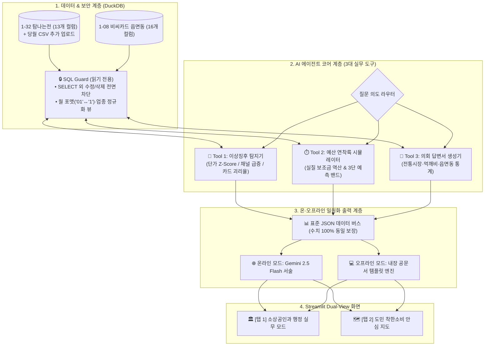

# 🛠️ 탐나워치 (TamnaWatch) 시스템 상세 구축방안

> **목표 환경:** 제주빅데이터센터 폐쇄망 분석 PC (`Intel i7-8700 / GTX 1060 / 32GB RAM`) 및 일반 웹 환경 완벽 호환  
> **데이터 규격:** 제주빅데이터센터 데이터명세서 `v12 (2026.1.28)` **100% 준수**

---

## 1. 시스템 아키텍처 한눈에 보기



---

## 2. 데이터베이스 스키마 및 정규화 설계 (`data_pipeline.py`)

### 2.1 원본 테이블 구조 (센터 명세서 100% 일치)

| 테이블 구분 | 테이블명 | 컬럼 구성 (총 개수) |
| :--- | :--- | :--- |
| **주력 필수 (`1-32`)** | `tb_local_currency` | `pt_year`, `pt_month`(**`'01'`**), `base_ymd`, `zip_code`(5자리 우편번호), `card_cd`, `card_nm`(6개 매입사), `biz_cd`, `biz_nm`(세부업종), `induty`(표준업종), `amount`(금액), `cnt`(건수), `emd`(읍면동), `mrkt_nm`(전통시장) **(13개)** |
| **교차 검증 (`1-08`)** | `tb_bc_jeju_emd_v02` | `base_year_month`, `pt_year`, `pt_month`(**`'1'`**), `dstrct_se`, `city`, `area_type`, `bjd`(73개 법정동), `biz_cd`, `biz_nm`(42개 업종), `user_type`, `tour_type`, `age`, `sex`, `user_cnt`, `use_cnt`, `use_amt` **(16개)** |

### 2.2 조인 오류 방지 및 시차 극복 설계
1. **월(Month) 표기 정규화:** `1-32`는 `'01'`, `1-08`은 `'1'`로 표기가 달라 조인 시 누락되는 문제를 막기 위해 `LPAD(TRIM(pt_month), 2, '0')`로 자동 변환합니다.
2. **업종·지역 매핑 뷰 (`vw_crosswalk`):** `1-32`의 `induty(표준업종)`·`emd(읍면동)`와 `1-08`의 `biz_nm(42개 업종)`·`bjd(법정동)`를 표준 매핑 뷰로 연결합니다.
3. **당월 CSV 추가 업로드 브릿지:** 센터의 월별 누적 데이터 위에 주무관이 당월 일별 CSV를 드래그 앤 드롭하면 임시 뷰로 즉시 병합 분석합니다.
4. **샘플 데이터 자동 시더(Seeder):** 평가 PC에 원본 CSV가 없을 경우, 실행 즉시 명세서 규격과 100% 동일한 시뮬레이션 데이터를 자동 생성해 에러를 방지합니다.

---

## 3. 핵심 모듈별 알고리즘 요약

| 모듈 파일명 | 핵심 알고리즘 및 수식 | 최종 실무 산출물 |
| :--- | :--- | :--- |
| **`fraud_detector.py`**<br>(부정유통 이상징후 탐지) | **3대 이상징후 복합 스코어링:**<br>① **건당 단가 이상치:** 동일 업종(`biz_cd`) 평균 대비 건당 결제액(`amount/cnt`) $Z > 3.0$<br>② **채널 스파이크:** 할인 상향 기간 `직승인·코나카드` 일별 결제액 평시 대비 5~10배 급증<br>③ **카드 괴리율:** 비씨카드(`1-08`) 매출 증감률 대비 탐나는전 단독 급증 (상권 호황 오탐 제거) | • 고위험 블록(`우편번호×업종×채널`) Top 3 리스트<br>• 현장 점검 대조용 **일자별 거래 증빙표** |
| **`budget_simulator.py`**<br>(예산 연착륙 시뮬레이터) | **실질 보조금 역산 & 3단 예측 밴드:**<br>• 일별 실질 예산 소진액 = $\sum \text{amount}_d \times r_{\text{policy}}$ (정책 적립률 7~15%)<br>• 명절·월초 가중치($W_{event}$) 반영 **3단 시나리오(보수·중립·완만)** 소진일 예측<br>• 월 한도 조정(50만→30만 원) 시 일별 소진액 절감 효과 시뮬레이션 | • 예산 소진 D-Day 3단 예측 밴드 차트<br>• **도지사/국장 방침 결재 보고서 및 한도 조정 공고문 초안** |
| **`report_generator.py`**<br>(도의회 답변서 생성기) | **3대 행감 단골 질의 자동 집계:**<br>① 전통시장(`mrkt_nm`) 유입 비중 및 골목상권 기여도<br>② 제주시 도심 대 읍·면 외곽(`emd`) 지역 균형도<br>③ 공공배달앱 `먹깨비`(`card_nm`) 연계 결제 실적 | • 도의회 제출용 **표준 통계표(CSV/마크다운)**<br>• **행정사무감사 질의 답변서 초안(Draft)** |
| **`agent_core.py`**<br>(온·오프라인 통합 코어) | **보안 가드 & 온·오프라인 일원화 버스:**<br>• `SELECT` 외 쿼리 원천 차단 (`read_only` SQL Guard)<br>• 온라인(Gemini API)과 오프라인(내장 템플릿) 모두 **동일한 SQL 집계 JSON 버스**를 공유하여 인터넷 유무와 무관하게 **수치 100% 일치** 보장 | • 자연어 질의응답 인터페이스<br>• 폐쇄망 무중단 리포트 출력 |

---

## 4. 센터 분석 PC (`i7-8700 / GTX 1060 / 32GB RAM`) 최적화

* **초경량 메모리 점유:** 무거운 딥러닝 프레임워크(PyTorch 등)를 배제하고 **DuckDB 인메모리 컬럼형 엔진**을 사용하여 RAM 2GB 내외(전체 32GB의 6%)만 사용합니다.
* **필수 패키지 최소화:** `duckdb`, `streamlit`, `plotly`, `pandas`, `numpy` 5개 표준 패키지만으로 구성하여 설치 충돌 가능성을 차단했습니다.

---

## 5. 프로젝트 폴더 구조

```text
jejuproject_1/
├── README.md                 # 센터 PC 원클릭 실행 매뉴얼 & 데이터 명세 매핑표
├── requirements.txt          # 경량 필수 라이브러리 목록
├── .env.example              # 환경변수 예시 (API 키 없어도 오프라인 모드 100% 작동)
├── data/
│   ├── raw/                  # 1-32(tb_local_currency) & 1-08(tb_bc_jeju_emd_v02) 데이터 폴더
│   └── processed/            # DuckDB 캐시 폴더
├── src/
│   ├── data_pipeline.py      # 스키마 생성, 정규화 뷰, 샘플 시더(Seeder), 읽기 전용 SQL Guard
│   ├── fraud_detector.py     # Tool 1: 3대 이상징후 탐지 및 거래 증빙표 생성
│   ├── budget_simulator.py   # Tool 2: 실질 보조금 역산 및 3단 예산 연착륙 시뮬레이터
│   ├── report_generator.py   # Tool 3: 도의회 행감 답변서 초안 및 오프라인 템플릿 렌더러
│   └── agent_core.py         # 에이전트 라우터 및 온·오프라인 표준 JSON 데이터 버스
├── app.py                    # Streamlit Dual-View 대시보드 (탭1: 실무 모드 / 탭2: 도민 모드)
└── docs/
    ├── MASTER_PLAN.md        # 마스터플랜 최종본
    └── IMPLEMENTATION_PLAN.md# 시스템 상세 구축방안 최종본
```
