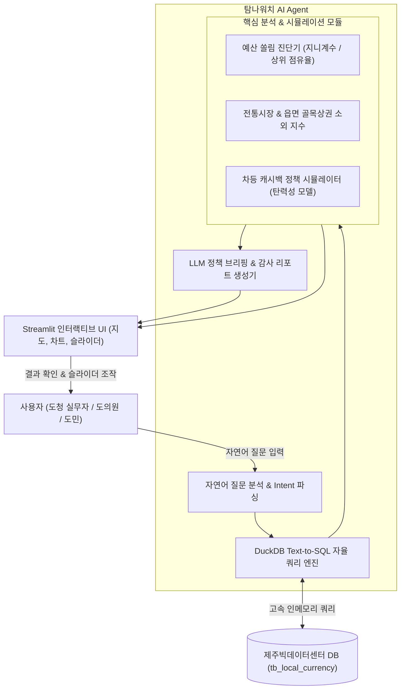

# 🏛️ 탐나워치 (TamnaWatch) : 탐나는전 예산 쏠림 감사 & 차등 캐시백 정책 시뮬레이터 AI

> **"연간 수백억 원의 탐나는전 할인 예산, 진짜 골목상권으로 흐르고 있는가?"**  
> IT 비전문가(도청 공무원·도의원·도민)가 자연어로 제주빅데이터센터의 탐나는전 결제 데이터를 실시간 감사하고, 골목상권을 살리는 최적의 차등 캐시백 정책을 시뮬레이션하는 자율형 AI Agent

---

## 📌 1. 프로젝트 개요 (Problem & Solution)

### 1.1 해결하려는 진짜 문제 (제주도정·도의회 최대 현안)
* **연간 수백억 원 혈세 투입:** 제주도는 지역경제 활성화를 위해 매년 수백억 원의 도민 세금으로 탐나는전 7~10% 현장 할인(캐시백)을 지원함.
* **골목상권 소외와 대형 쏠림의 역설:** 당초 목적은 "영세 소상공인·전통시장 지원"이었으나, 실제로는 **제주시내 대형 식자재마트, 특정 대형 가맹점, 병원 등 상위 5% 가맹점이 예산의 절반 이상을 독식**하고 읍·면 영세 상인은 소외됨 (제주도의회 행정사무감사 단골 지적).
* **분석 역량의 병목:** 도청 소상공인과와 의회는 "어디로 예산이 새는지" 진단하고 싶지만, 센터에 쌓인 수백만 건의 결제 데이터를 다룰 파이썬/SQL 인력이 없어 정기 감사가 불가능함.

### 1.2 솔루션: 탐나워치 (TamnaWatch AI Agent)
* **자연어 질의 (Text-to-SQL):** *"올해 10% 캐시백 예산, 전통시장에 얼마나 들어갔고 상위 10개 가맹점 쏠림은 어때?"*라고 치면 Agent가 센터 DB를 자율 분석.
* **실시간 쏠림 진단 (Gini / Concentration Index):** 예산 독식률, 업종별 편중도, 읍·면 골목상권 소외 지수를 한눈에 시각화.
* **차등 캐시백 정책 시뮬레이터:** *"연매출 10억 초과 가맹점 캐시백을 5%로 낮추고, 전통시장/읍면을 12%로 올리면 골목상권으로 얼마가 더 유입될까?"*를 3초 만에 시뮬레이션.
* **원클릭 도의회/도청 제출용 감사 보고서 자동 발행:** 표, 그래프, 정책 제언이 포함된 마크다운/PDF 리포트 생성.

---

## 📊 2. 활용 데이터 명세 (제주빅데이터센터 v12 규격 100% 일치)

### 2.1 주력 필수 데이터 (Primary)
* **테이블명:** `1-32 탐나는전 이용 현황 (tb_local_currency)`
* **출처:** 제주빅데이터센터 (제주특별자치도 소상공인과)
* **활용 컬럼:**
  | 컬럼명 (영문) | 컬럼명 (한글) | 데이터형 | 활용 목적 |
  | :--- | :--- | :--- | :--- |
  | `base_ymd` | 기준일자 | STRING | 시계열 예산 소진 추이 및 할인 이벤트 전후 분석 |
  | `card_nm` | 카드구분 | STRING | BC, 국민, 코나, **먹깨비(공공배달)** 등 결제 채널 구분 |
  | `biz_nm` | 가맹점명/업종 | STRING | 상위 가맹점 매출 집중도 및 업종별 쏠림 추적 |
  | `amount` | 이용금액 | BIGINT | 할인 지원금(7~10%) 실질 투입액 역산 |
  | `cnt` | 이용건수 | INT | 소액 결제(골목상권) vs 고액 결제(대형 가맹점) 패턴 분리 |
  | `emd` | 읍면동 | STRING | 제주시 동지역 vs 읍·면 외곽 지역 간 수혜 불균형 분석 |
  | `mrkt_nm` | 전통시장명 | STRING | 전통시장 실질 유입액(NULL 여부) 검증 |

### 2.2 교차 검증 보조 데이터 (Secondary)
* **테이블명:** `1-08 카드 이용 현황 (읍면동)`
  * 목적: 일반 신용카드 소비 대비 탐나는전 점유율(침투율)을 비교하여, 탐나는전이 '진짜 골목 소비를 창출했는지' 아니면 '어차피 쓸 돈에 세금만 얹어줬는지' 검증.

---

## 🤖 3. AI Agent 아키텍처 및 핵심 기능

### 3.1 핵심 4대 기능
1. **[자연어 자율 감사]:** SQL을 몰라도 "올해 10월 탐나는전 예산 어디로 가장 많이 샜어?"라고 물으면 스스로 쿼리 작성 후 실행.
2. **[골목상권 쏠림 지수(Gini Index) 측정]:** 탐나는전 결제액의 80%를 차지하는 상위 가맹점 리스트와 읍·면 소외 현황을 시각화.
3. **[차등 인센티브 정책 시뮬레이터]:**
   * 슬라이더로 정책 변수 조절:
     * 대형 가맹점 캐시백 요율: `[ 10% ➔ 5% ]`
     * 전통시장/골목상권 요율: `[ 10% ➔ 12% ]`
     * 월 결제 한도: `[ 50만 원 ➔ 30만 원 ]`
   * AI가 과거 결제 탄력성을 바탕으로 **"예산 절감액: 45억 원, 골목상권 추가 유입: 110억 원"** 예측 결과 즉시 렌더링.
4. **[원클릭 행정 보고서 발행]:** 도의회 행정사무감사 양식의 마크다운/PDF 리포트 원클릭 다운로드.

---

## 🏆 4. 해커톤 5대 심사 기준 100% 매핑 전략

| 평가 항목 (배점) | 탐나워치 구현 전략 | 심사위원 어필 포인트 |
| :--- | :--- | :--- |
| **1. AI Agent 기술성 및 완성도 (25점, 동점 1순위)** | • Text-to-SQL + 시뮬레이션 파이프라인 자율 수행 • DuckDB 기반 센터 PC 저사양 최적화 | 질문 하나로 쿼리 $\rightarrow$ 계산 $\rightarrow$ 시뮬레이션 $\rightarrow$ 보고서까지 에이전트 완결성 입증 |
| **2. 편의성 및 실용성 (25점, 동점 2순위)** | • IT 비전문가 공무원을 위한 No-Code 인터페이스 • 정책 슬라이더 직관적 UI | 센터 PC에 설치하면 내일 당장 도의회 감사 준비에 쓸 수 있는 실무 도구 |
| **3. 필수 데이터 활용 적절성 (20점, 동점 3순위)** | • 센터 고유 테이블 `1-32` 영문 컬럼 100% 매핑 • 전통시장(`mrkt_nm`), 공공배달(`먹깨비`) 실질 분석 | 남들이 안 쓰는 센터 독점 테이블의 존재 이유를 가장 완벽하게 증명 |
| **4. 분석 주제 타당성·창의성 (15점)** | • 기수상작 중복 0건 (완전 무주공산) • 도의회·언론 매년 지적하는 예산 쏠림 정조준 | 단순 상권/관광 분석 탈피, 수백억 도민 세금 누수 감시라는 압도적 공익성 |
| **5. 결과 신뢰성 및 재현성 (15점)** | • 오프라인 Fallback 모드 (인터넷/API 키 없이 구동) • 센터 PC (`i7-8700 / GTX 1060`) 100% 재현 매뉴얼 | 심사위원이 압축 풀고 실행 명령어 한 줄 치면 에러 없이 즉시 구동 |

---

## 📅 5. 단계별 실행 계획 (Roadmap)

* **Step 0: 마스터플랜 확정 및 GitHub 동기화 (현재 완료)**
* **Step 1: 데이터 파이프라인 및 스키마 세팅**
  * `1-32 탐나는전` 명세서 기반 합성/실제 샘플 데이터 생성
  * DuckDB 인메모리 쿼리 엔진 및 기본 쏠림 통계 로직 구축
* **Step 2: AI Agent 두뇌 (Text-to-SQL + 시뮬레이터) 개발**
  * 도정 감사 특화 프롬프트 엔지니어링 & 툴 콜링
  * 차등 캐시백 정책 시뮬레이션 수학 모델링
* **Step 3: Streamlit 인터랙티브 대시보드 UI 개발**
  * 직관적 감사 브리핑 카드 + 정책 슬라이더 + 보고서 다운로드
* **Step 4: 오프라인 재현성 검증 & 15p 기획서 작성**
  * 센터 PC 스펙 검증, `README.md` 작성, 최종 `.zip` 패키징 준비
