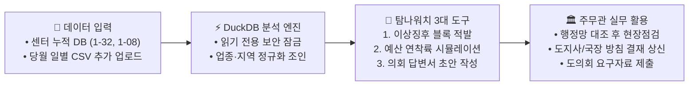

# 🏛️ 탐나워치 (TamnaWatch) 마스터플랜

> **한 줄 정의:** 제주도청 소상공인과 주무관의 의사결정을 보좌하는 **탐나는전 이상징후 탐지 & 예산 연착륙 실무 AI 에이전트 (Copilot)**

---

## 1. 왜 필요한가? (제주도청 실무자의 3대 고충과 해결책)

| 구분 | 도청 소상공인과 주무관의 실제 고충 (Pain Point) | 탐나워치(TamnaWatch)의 해결책 (Solution) |
| :--- | :--- | :--- |
| **① 부정유통 단속** | • 현재 대행사 시스템(FDS)과 주민신고를 병행 중이나, **탐나는전 내부 데이터만** 볼 수 있음 • 매출 급증 시 **'진짜 상권 호황(정상)'인지 '캐시백을 노린 허위 결제(깡)'인지 구분 불가** (오탐 다수 발생) | **🚨 [교차검증 단속 타겟팅]** • **`1-32 탐나는전` + `1-08 비씨카드` 매출을 교차 검증** • 일반 카드 매출은 그대로인데 탐나는전만 폭증한 **고위험 블록(`우편번호×업종×매입사`)**만 정밀 추출 |
| **② 할인예산 관리** | • 실제로 **2024년 7월·12월 예산 조기 소진으로 적립이 돌연 중단**되어 도민 항의 폭주 • 명절·이벤트 기간 소진 속도를 예측할 시뮬레이션 도구가 없음 | **⏱️ [예산 연착륙 시뮬레이터]** • 결제총액(`amount`)에 적립률을 곱해 **일별 실질 예산 소진액** 역산 • 3단 예측 밴드(보수·중립·완만) 및 **한도 조정(50만→30만 원) 방침 보고서·공고문 초안** 생성 |
| **③ 도의회 감사 대응** | • 매년 10월 행감 때마다 *"전통시장에 얼마 갔냐, 읍면 불균형 어쩌냐"* 질의 쇄도 • 주무관이 수백만 건 원시 데이터를 엑셀 수작업으로 집계하느라 야근 반복 | **📝 [도의회 답변서 초안 생성]** • 자주 나오는 의원 질의 클릭 시 **전통시장(`mrkt_nm`)·먹깨비(`card_nm`)·읍면동(`emd`) 통계표와 답변서 초안** 즉시 생성 |

---

## 2. 어떻게 작동하는가? (핵심 워크플로우)

---

## 3. 어떤 데이터를 쓰는가? (제주빅데이터센터 v12 규격 100% 준수)

### 3.1 주력 데이터: `1-32 탐나는전 이용 현황 (tb_local_currency)` (13개 전 컬럼 활용)

| 분류 | 컬럼명 (영문) | 컬럼명 (한글) | 데이터 예시 | 실무 활용 방식 |
| :--- | :--- | :--- | :--- | :--- |
| **시간** | `pt_year`, `pt_month`, `base_ymd` | 년, 월, 승인일자 | `2023`, `01`, `20230104` | 일별 예산 소진 속도 계산 및 명절·이벤트 스파이크 탐지 |
| **공간** | **`zip_code`**, `emd`, **`mrkt_nm`** | **우편번호**, 읍면동, **전통시장** | `63122`, `연동`, `동문재래시장` | **5자리 우편번호(골목 블록) 단위 이상징후 특정** 및 전통시장 유입액 집계 |
| **채널** | `card_cd`, **`card_nm`** | 매입사 코드·**매입사명** | `BC, 국민, 먹깨비, 삼성, 직승인, 코나` | **`직승인·코나카드` 편중 결제(깡 의심)** 포착 및 공공배달앱 **`먹깨비`** 실적 분리 |
| **업종** | `biz_cd`, **`biz_nm`**, **`induty`** | 업종코드, **업종명**, **표준업종** | `귀금속점, 간이음식점` | 세부 업종별 정상 단가 기준선 산출 및 비씨카드 업종 교차 매핑 |
| **실적** | **`amount`**, **`cnt`** | **금액**, **건수** | 결제금액(원), 건수(건) | **건당 평균 결제단가(`amount / cnt`)** 및 실질 인센티브 예산 역산 |

### 3.2 교차검증 데이터: `1-08 카드 이용 현황(읍면동)_v02 (비씨카드)`
* **활용 컬럼:** `base_year_month`(년월), `bjd`(73개 법정동), `biz_cd`/`biz_nm`(42개 업종), `use_amt`(이용금액), `use_cnt`(이용건수)
* **활용 목적:** 일반 신용카드 소비 추세와 탐나는전 결제 추세를 비교해 **'진짜 상권 호황(오탐)'을 걸러내고 '탐나는전 단독 이상 급증'만 선별**

---

## 4. 데이터 한계를 극복한 3대 실무 설계 포인트

1. **상호명 비식별 한계 극복 (`우편번호 5자리 × 세부업종` 타겟팅)**
   * 센터 데이터는 개인정보 보호를 위해 개별 상호명 대신 **`5자리 우편번호(zip_code) + 세부업종(biz_nm)`**을 제공합니다.
   * 귀금속점 등 고위험 특수업종은 한 우편번호 구역 내 1~3곳뿐이며, 일반 음식점도 이상 결제채널(`직승인` 등)로 좁히면 **주무관이 행정망 대장과 대조해 점검 대상을 수만 개에서 수 개 이내로 즉시 압축**할 수 있습니다.
2. **월별 업데이트 시차 극복 (`센터 누적 DB + 당월 CSV 업로드` 하이브리드)**
   * 센터 DB(`1-32`)는 월별 누적 업데이트 방식입니다.
   * 따라서 **평소에는 센터 누적 데이터로 업종·구역별 정상 기준선(Baseline)을 학습**하고, **당월 예산을 긴급 점검할 때는 주무관이 대행사 당월 일별 CSV를 화면에 추가 업로드**해 실시간 분석하도록 설계했습니다.
3. **결제총액(`amount`)과 지원예산 구분**
   * 결제총액(`amount`)에 **정책 캐시백 적립률(7~15%)**을 곱해 실제 도비 지원 예산 소진액을 정확히 역산합니다.

---

## 5. 화면 구성 (Dual-View 대시보드)

* **🖥️ [탭 1: 소상공인과 행정 실무 모드]**
  * **단속 타겟 카드:** 부정유통 의심 핫스팟 블록 Top 3 (`우편번호 × 업종 × 매입사`) 및 현장 대조용 거래 증빙표 출력
  * **예산 연착륙 시뮬레이터:** 예산 소진 D-Day 3단 예측 그래프 & 방침 결재 보고서·공고문 초안 자동 생성
  * **도의회 행감 도우미:** 3대 단골 질의(전통시장 비중, 읍면 불균형, 먹깨비 실적) 원클릭 통계표 & 답변서 초안 다운로드
* **🗺️ [탭 2: 도민 착한소비 안심 지도]**
  * 도민을 위한 **우리 동네 우편번호(`zip_code`)·전통시장(`mrkt_nm`)·먹깨비 기반 알뜰 소비 권역 지도**
  * 정량 인증 기준: ① 건당 평균 3만 원 이하 소액결제 업종, ② 전통시장·먹깨비 활성화 구역, ③ 최근 6개월 이상징후 0건 청정 구역

---

## 6. 추진 일정 (D-15 로드맵: 11.05 ~ 11.20)

| 단계 | 일정 | 핵심 수행 내용 |
| :--- | :---: | :--- |
| **Step 0** | **11/05 (완료)** | 마스터플랜 및 시스템 상세 구축방안 최종 확정 |
| **Step 1** | **11/05 ~ 11/07** | DuckDB 데이터 파이프라인, `1-32`/`1-08` 스키마·정규화 뷰 및 읽기 전용 보안 가드 구축 |
| **Step 2** | **11/08 ~ 11/11** | 3대 핵심 모듈(`fraud_detector`, `budget_simulator`, `report_generator`) 및 에이전트 코어 개발 |
| **Step 3** | **11/12 ~ 11/15** | Streamlit Dual-View UI 대시보드(실무자 탭 + 도민 탭) 및 CSV 업로드 브릿지 구현 |
| **Step 4** | **11/16 ~ 11/19** | 센터 PC(`i7-8700 / 32GB RAM`) 오프라인 구동 검증, 15p 기획서(PDF) 및 최종 `.zip` 패키징 |
